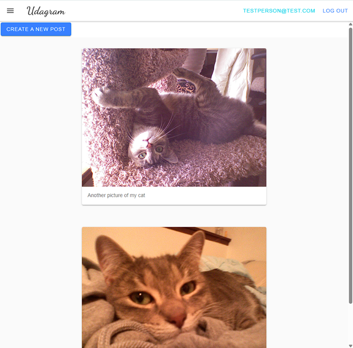

# Udagram

This application is provided by Udacity as an alternative starter project if you do not wish to host your own code done in the previous courses of this nanodegree. The Udagram application is a fairly simple application that includes all the major components of a Full-Stack web application.

## Live App

CircleCI build status:

The deployed app frontend can be found here: [http://benh-udagram-bucket.s3-website-us-east-1.amazonaws.com](http://benh-udagram-bucket.s3-website-us-east-1.amazonaws.com).

The deployed app backend API endpoint is here: [http://udagram-api-dev.us-east-1.elasticbeanstalk.com/api/v0/feed](http://udagram-api-dev.us-east-1.elasticbeanstalk.com/api/v0/feed). **Please note that the backend API only works when "Cloud Resources" is started as explained in the class, and only runs for about a few hours.**

## Documentation

* [Infrastructure Description](documentation/infrastructure-description.md)
* [Dependencies for the API and frontend](documentation/app-dependencies.md)
* [Pipeline Process](documentation/pipeline-process.md)

## Running locally

Note: The frontend does not appear to build/run with the latest version of NodeJS (v24 as of Oct. 2026). The recommended version to use is Node v14. I recommend using Node Version Manager (NVM), which allows you to easily switch between different versions of Node.

* macOS/Linux/WSL: [https://github.com/nvm-sh/nvm](https://github.com/nvm-sh/nvm)
* Windows: [https://github.com/nvm-windows/nvm](https://github.com/nvm-windows/nvm)

Provision the necessary AWS services needed for running the application:

1. In AWS, provision a publicly available RDS database running Postgres. [Classroom article](https://learn.udacity.com/nd0067?version=5.0.19&partKey=cd0295&lessonKey=57cc3ecb-741f-45e4-ab5b-c0ccc589fe10&conceptKey=f46d8307-65cf-41d1-92b4-aed9d96a878b)
2. In AWS, provision an S3 bucket for hosting the uploaded files. [Classroom article](https://learn.udacity.com/nd0067?version=5.0.19&partKey=cd0295&lessonKey=57cc3ecb-741f-45e4-ab5b-c0ccc589fe10&conceptKey=6df5a01b-960a-4fe9-a79e-66e52a7f6ae4)
3. Export the [ENV variables](udagram\udagram-api\src\config\README.md) needed or use a package like [dotenv](https://www.npmjs.com/package/dotenv)/.
4. From the root of the repo, navigate udagram-api folder `cd starter/udagram-api` to install the node_modules `npm install`. After installation is done start the api in dev mode with `npm run dev`.
5. Without closing the terminal in step 1, navigate to the udagram-frontend `cd starter/udagram-frontend` to intall the node_modules `npm install`. You may need to do a forced install `npm install -f`. After installation is done start the api in dev mode with `npm run start`.

## Testing

This project contains two different test suites: unit tests and End-To-End tests(e2e). Follow these steps to run the tests.

1. `cd starter/udagram-frontend`
2. `npm run test`
3. `npm run e2e`

There are no Unit test on the back-end

### Unit Tests

Unit tests are using the Jasmine Framework.

### End to End Tests

The e2e tests are using Protractor and Jasmine.

## Built With

* [Angular](https://angular.io/) - Single Page Application Framework
* [Node](https://nodejs.org) - Javascript Runtime
* [Express](https://expressjs.com/) - Javascript API Framework

## License

[License](LICENSE.txt)
