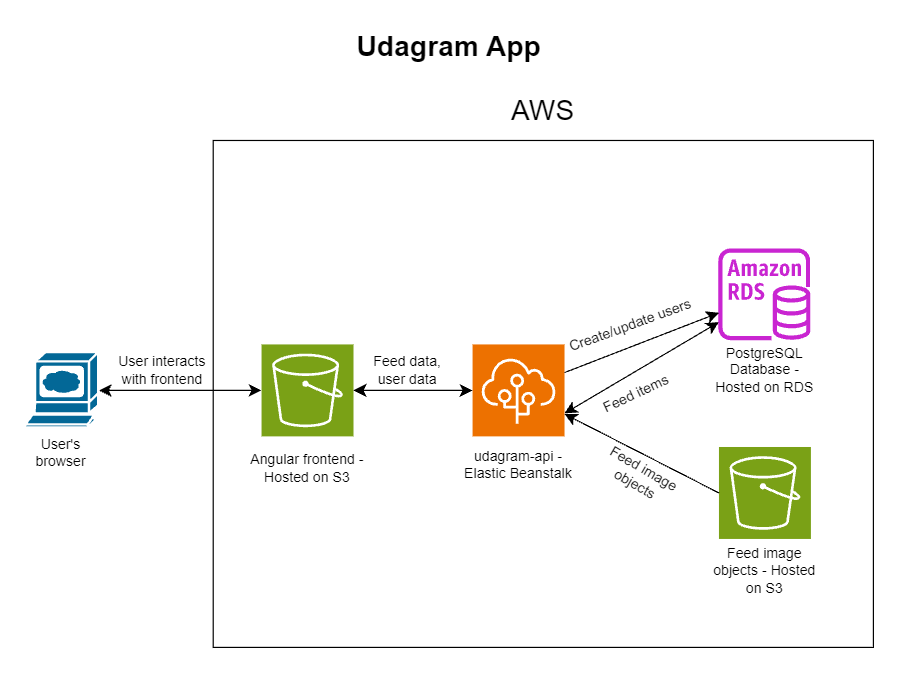

# Infrastructure Description

Udagram is a web app hosted on AWS. Its infrastructure has three main parts: an Angular (Ionic) frontend served from Amazon S3, a Node.js (Express) API running on AWS Elastic Beanstalk, and a PostgreSQL database hosted by Amazon RDS. The API also uses S3 to store uploaded feed images.

## Architecture

The frontend makes API requests to the API endpoint configured in the Angular environment. The API reads and writes application data in PostgreSQL. For feed images, the API creates short-lived signed S3 URLs that the frontend uses to upload or retrieve objects.

## AWS resources

### Frontend: Amazon S3

The Angular app is built and output to the `www` directory, then uploaded to an S3 bucket configured for static website hosting. The deployment script makes the frontend objects publicly readable and sets the `index.html` cache policy to revalidate on each request, so new frontend releases are picked up promptly.

The current deployment serves the frontend at [the S3 website endpoint](http://benh-udagram-bucket.s3-website-us-east-1.amazonaws.com).

### API: AWS Elastic Beanstalk

The API is a Node.js/Express app deployed to the Elastic Beanstalk application named `udagram-api`, in the `udagram-api-dev` environment. The repo's Elastic Beanstalk configuration specifies the `us-east-1` region and the Node.js 22 platform on Amazon Linux 2023. The API listens on port `8080`; Elastic Beanstalk provides its environment endpoint for clients to call.

The API endpoint used by this deployment is [udagram-api-dev](http://udagram-api-dev.us-east-1.elasticbeanstalk.com/api/v0/feed). The classroom environment may be stopped when not in use, so this endpoint is not guaranteed to remain available.

### Database: Amazon RDS

Amazon RDS hosts the application's PostgreSQL database. The API reads the database host, name, username, and password from environment variables and connects using Sequelize. Database connection settings enable SSL.

### Uploaded images: Amazon S3

The API uses the AWS SDK to create signed `PUT` and `GET` URLs for feed image objects. These URLs expire after five minutes. The bucket and AWS region are provided through the API's environment configuration.

The frontend deployment script publishes static site files to its configured bucket, while the API's `AWS_BUCKET` setting identifies the bucket used for media. These can be configured as the same bucket or as separate buckets; the API configuration guide recommends a separate media bucket.

## Configuration and access

The API requires environment variables for its PostgreSQL connection, AWS region and media bucket, and JWT signing secret. When running locally, you may use dotenv, or add a `set_env.sh` file in the `udagram` directory, and run `source set_env.sh` from that directory - [file from original forked repo](https://github.com/udacity/nd0067-c4-deployment-process-project-starter/blob/master/udagram/set_env.sh). AWS credentials must also be available to the AWS SDK. Keep credentials and secrets out of source control; configure them in the deployment environment or use a local environment file that is not committed.

The website is publicly accessible, and the frontend deployment script grants public-read access to uploaded website objects. AWS resource names and endpoints above describe the current classroom deployment; they may need to be changed when provisioning a separate environment.
